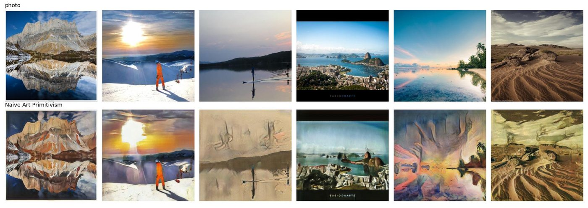
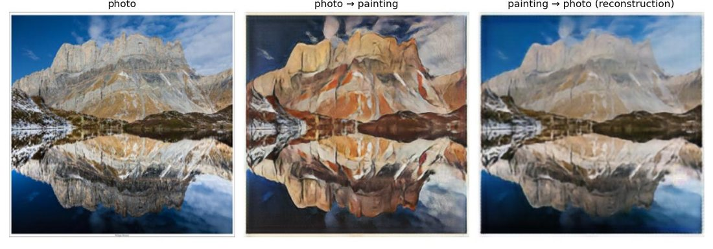
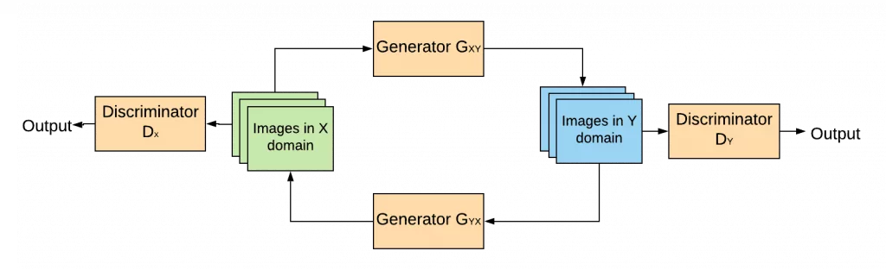
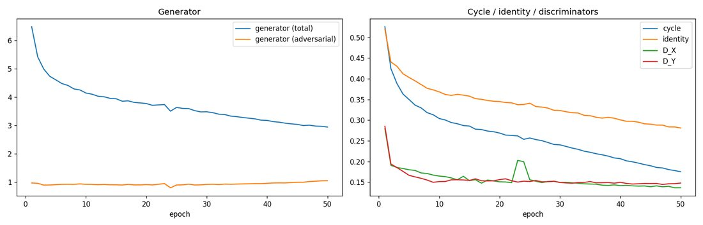

# Landscape → Painting with CycleGAN

**Unpaired image-to-image translation** that turns landscape photographs into paintings in a chosen art style. It is a CycleGAN implemented from scratch in PyTorch and trained on a Kaggle T4 GPU.


<sub>Top row: landscape photos the model never saw during training. Bottom row: the same photos translated to **Naive Art / Primitivism** after 50 epochs.</sub>

[](https://github.com/mahdi-ahmadi-2002/Style-Transfer-Landscape2Art/actions/workflows/smoke-test.yml)
 

## Results at a glance

| | |
|---|---|
| Task | landscape photo → Naive Art / Primitivism painting, **no paired data** |
| Data | 4,074 training photos · 56 held-out test photos · 2,405 WikiArt paintings |
| Model | ResNet-9 generator (11.4 M params) + 70×70 PatchGAN discriminator (2.8 M params), ×2 |
| Training | 50 epochs, batch 4, mixed precision, **13.1 GPU-hours** on one Tesla T4, across two Kaggle sessions with checkpoint resume |
| **FID ↓** (56 held-out photos vs 500 real paintings) | **266.1** stylized vs **298.1** untranslated photos, **−32.0 (−10.7 %)** |
| Cycle reconstruction (L1, 0–1 pixel scale) | **0.042 ± 0.014**, versus an average change of **0.109** from photo to painting |
| Final training losses (epoch 1 → 50) | generator 6.48 → 2.94 · cycle 0.526 → 0.175 · identity 0.520 → 0.281 · D_X / D_Y 0.28 → 0.14 / 0.15 |

The stylized photos are measurably closer to the painting distribution than the raw photos are, and photo → painting → photo recovers the original image closely:



## Highlights

- **Full CycleGAN implemented from scratch:** ResNet-9 generators, PatchGAN discriminators, LSGAN, cycle-consistency and identity losses, a 50-image history pool and linear LR decay, following Zhu et al. (2017).
- **Robust training pipeline:**
  - Datasets are found automatically.
  - Mixed-precision (AMP) training.
  - Atomic checkpoints are written after every epoch.
  - **Training resumes automatically across sessions.** This run stopped at Kaggle's 12-hour limit at epoch 41 and resumed to epoch 50.
  - A time budget stops training before the session limit.
  - Corrupt images are skipped.
- **Data cleaning:** 189 black-and-white photos (4.4 %) are detected by comparing colour channels and removed, because they carry no colour to learn a palette from. Filtering happens after the train/test split, so the test set stays disjoint from training even when a run is resumed.
- **Evaluation:**
  - Visual results on held-out photos.
  - Cycle-reconstruction error.
  - **FID** against a no-translation baseline, computed with torchvision Inception-v3 and scipy, so nothing needs to be pip-installed.
- **Tested in CI:** an end-to-end smoke test runs every notebook cell on synthetic data. It covers training, resume, evaluate-only mode, the grayscale filter and the missing-checkpoint error.

## Method



Two generators learn opposite mappings, **G: X→Y** (photo → painting) and **F: Y→X**. Two discriminators, **D_Y** and **D_X**, judge whether images look real.

| Component | Choice | Why |
|---|---|---|
| Generator | ResNet-9: c7s1-64, 2× stride-2 down, 9 residual blocks, 2× up, tanh; reflection padding, InstanceNorm | the residual path keeps scene structure; reflection padding avoids border artifacts |
| Discriminator | 70×70 PatchGAN (C64-C128-C256-C512) | scores local patches, which matches brush-stroke texture |
| Adversarial loss | LSGAN (MSE) | more stable gradients than BCE |
| Cycle loss | L1, λ_cyc = 10 | `F(G(x)) ≈ x` keeps content when there are no pairs |
| Identity loss | L1, **λ_id = 0.5** | λ_id ≈ 5 gave near-identity outputs; 0.5 balanced style and content |
| Optimisation | Adam (2e-4, β₁ = 0.5), constant for 25 epochs, then linear decay to 0; 50-image history pool | standard CycleGAN recipe |
| Data | 256×256; resize to 286, random crop, horizontal flip; normalised to [-1, 1] | |

**Training curves (50 epochs):**



The cycle and identity losses fall steadily for all 50 epochs. Both discriminators stay around 0.14–0.15, with no collapse. The generator's adversarial loss rises slightly once the learning rate starts decaying, as expected when the discriminators get sharper.

## Findings

From this run:

1. **Lower loss doesn't guarantee better images, so the notebook judges models visually and with FID.** It saves a fixed-input preview after every epoch and reports FID against a no-translation baseline.
2. **Black-and-white photos hurt the showcase.** Three of the first six gallery images were grayscale and stayed grey after translation. Removing them made the outputs colourful.

From earlier exploration with the original notebook (RTX 3070, about 8 h per 50 epochs per style, seven WikiArt styles):

3. **The identity weight controls the trade-off between style and content.** λ_id ≈ 5 kept the output almost identical to the input; λ_id = 0.5 balanced style and content.
4. **How well a style fits matters more than dataset size.** Naive Art and Cubism transferred well; Cubism produced faceted, blocky planes (below). Post-Impressionism (6.4k images, very diverse) oscillated. Pop Art overused saturated red. Northern Renaissance and Pointillism acted like colour filters, because their defining detail is invisible at 256².
5. **Training longer did not help.** Going from 50 to 150 epochs lowered the loss but added little visible improvement.


## Run it on Kaggle

1. **Create the notebook.** On Kaggle, create a new notebook, then use **File → Import Notebook** and upload [`landscape2art_cyclegan.ipynb`](landscape2art_cyclegan.ipynb).
2. **Add the datasets.** Under **Add Input**, add [`arnaud58/landscape-pictures`](https://www.kaggle.com/datasets/arnaud58/landscape-pictures) and [`steubk/wikiart`](https://www.kaggle.com/datasets/steubk/wikiart). No paths are needed; the notebook finds them.
3. **Set the session options.** Accelerator **GPU T4 x2**; only one GPU is used. Avoid P100: current Kaggle images ship CUDA 13 builds of PyTorch. Turn **Internet** on, which is only needed to download the Inception weights for FID.
4. **Run.** Click **Save Version → Save & Run All (Commit)**. It runs in the background. Each epoch takes about 14–16 min on a T4, so 50 epochs need two sessions.
5. **Resume.** Open the stopped version → **Output** → **⋮ → New dataset** (private), attach that dataset, and commit again. The log should say `Resumed from ... at epoch N/50`. Attach a dataset rather than the notebook output itself: if a version ends with an error, Kaggle mounts its output as an empty folder.
6. **Evaluate without training.** Set `TRAIN = False` and run all cells. The notebook loads the latest checkpoint and recomputes the gallery, cycle check and FID in a few minutes.

**Other settings** are in the first cell:
- `ART_STYLE` selects the style, e.g. `Cubism`, `Pop_Art` or `Ukiyo_e`.
- `MY_PHOTOS_DIR` stylizes your own photos at up to 1024 px.

**Outputs:**

| File | Contents |
|---|---|
| `generator_<style>.pt` | inference weights (45.5 MB) |
| `checkpoints/last.pt` | full training state, for resuming |
| `history.csv`, `losses.png` | losses per epoch |
| `samples/` | one preview per epoch |
| `results/`, `gallery.jpg`, `cycle.jpg` | held-out results |
| `metrics.json` | FID results |

To run locally: `pip install -r requirements.txt`, then set `LANDSCAPE_DIR` and `ART_DIR` in the first cell. To run the smoke test: `python tests/smoke_test.py`.

## Repository

```
landscape2art_cyclegan.ipynb   # full pipeline: data → model → training → evaluation → inference
                               # (saved with the outputs of the final Kaggle run, epochs 42–50)
tests/smoke_test.py            # runs every notebook cell on synthetic data (CI)
.github/workflows/             # CI workflow
assets/                        # README figures
requirements.txt
```

Trained weights and outputs are not stored in git. They are about 0.4 GB and are produced by the notebook.

## Limitations and ethics

- **No paired ground truth.** Evaluation relies on FID, cycle error and visual inspection.
- **FID is high in absolute terms.** With only 56 generated images, FID is biased upward and noisy, so use it to compare runs, not to compare with published numbers. It also uses torchvision's ImageNet Inception-v3, not the TF-Inception port used in papers.
- **The final model was trained on mixed data.** Epochs 1–41 still included the 189 black-and-white photos; the filter was added when the run resumed for epochs 42–50.
- **Resolution is limited to 256×256 during training.** Fine brushwork does not appear. Training at 512 px or adding super-resolution would be the next step.
- **WikiArt contains copyrighted works.** Generated images should not be presented as originals by the artists or movements they imitate.

## References

- Zhu, Park, Isola, Efros. *Unpaired Image-to-Image Translation using Cycle-Consistent Adversarial Networks.* ICCV 2017.
- Isola et al. *Image-to-Image Translation with Conditional Adversarial Networks* (PatchGAN). CVPR 2017.
- Johnson, Alahi, Fei-Fei. *Perceptual Losses for Real-Time Style Transfer* (ResNet generator). ECCV 2016.
- Mao et al. *Least Squares GANs.* ICCV 2017 · Ulyanov et al. *Instance Normalization.* 2016 · Heusel et al. *GANs Trained by a Two Time-Scale Update Rule Converge to a Local Nash Equilibrium* (FID). NeurIPS 2017.
