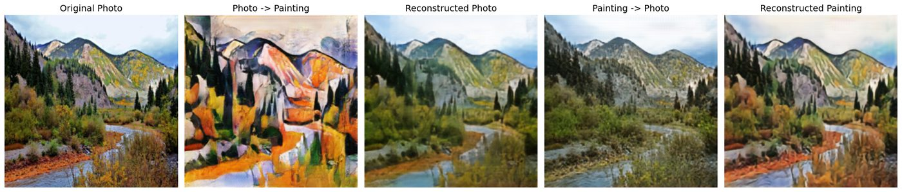
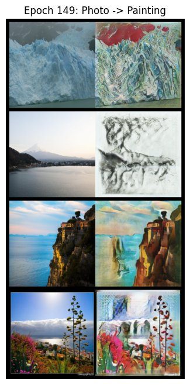
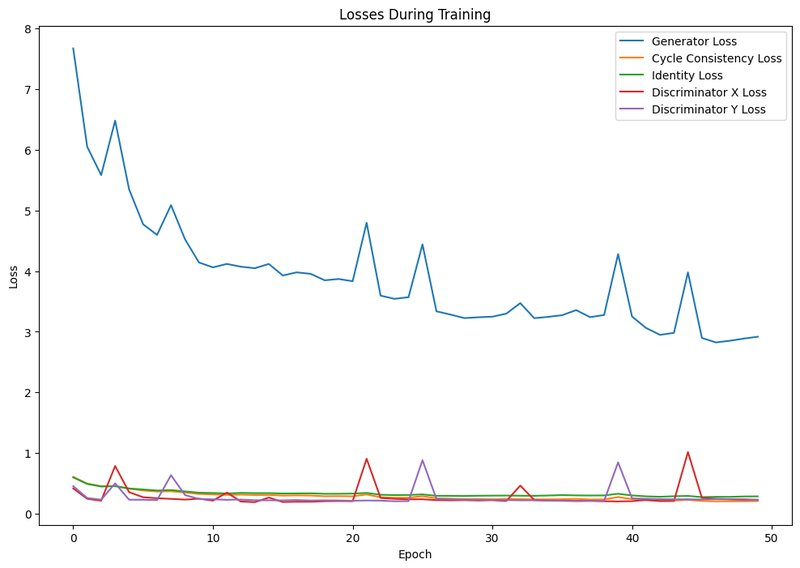

# Landscape → Painting with CycleGAN

**Unpaired image-to-image translation** that turns landscape photographs into paintings in a chosen art style, built from scratch in PyTorch.


<sub>Left to right: input photo · photo → Naive-Art painting · reconstruction back to a photo · painting → photo · reconstruction. The mountain ridges, river and sky keep their layout while palette and texture change.</sub>

[](https://github.com/mahdi-ahmadi-2002/Style-Transfer-Landscape2Art/actions/workflows/smoke-test.yml)
 

## Highlights

- **Full CycleGAN built from scratch:** ResNet-9 generators, 70×70 PatchGAN discriminators, LSGAN, cycle-consistency and identity losses, an image history pool and linear LR decay, following Zhu et al. (2017).
- **No paired data:** about 4.3k landscape photos are translated into WikiArt styles using only domain-level labels.
- **Built to run reliably on Kaggle:** datasets are found automatically, mixed-precision (AMP) training, atomic checkpoints every epoch, **automatic resume** across sessions, a time budget that stops before Kaggle's 12-hour limit, and corrupt images are skipped.
- **Evaluated:** qualitative results on held-out photos, a cycle-reconstruction check, and **FID** compared against a no-translation baseline.
- **Tested:** an end-to-end smoke test runs every notebook cell on synthetic data in CI.
- **7 art styles studied.** Naive/Primitivism and Cubism work best. Failure modes of the other styles are analysed [below](#findings).

## Quick start (Kaggle, free GPU)

1. Import [`landscape2art_cyclegan.ipynb`](landscape2art_cyclegan.ipynb) into Kaggle.
2. Add the datasets [`arnaud58/landscape-pictures`](https://www.kaggle.com/datasets/arnaud58/landscape-pictures) and [`steubk/wikiart`](https://www.kaggle.com/datasets/steubk/wikiart).
3. Turn on **GPU** and **Internet**, then click **Save Version → Save & Run All**.

Full guide, including resuming and troubleshooting: **[KAGGLE.md](KAGGLE.md)**.

Running it locally works too: `pip install -r requirements.txt`, then set `LANDSCAPE_DIR` / `ART_DIR` in the first notebook cell.

## Method


Two generators learn opposite mappings, **G: X→Y** (photo → painting) and **F: Y→X**. Two discriminators, **D_Y** and **D_X**, judge whether images look real.

| Component | Choice | Why |
|---|---|---|
| Generator | ResNet-9: c7s1-64, 2× stride-2 down, 9 residual blocks, 2× up, tanh; reflection padding, InstanceNorm | residual path keeps scene structure; reflection padding avoids border artifacts |
| Discriminator | 70×70 PatchGAN (C64-C128-C256-C512) | scores local patches, which matches brush-stroke texture |
| Adversarial loss | LSGAN (MSE) | more stable gradients than BCE |
| Cycle loss | L1, λ_cyc = 10 | `F(G(x)) ≈ x` keeps content when there are no pairs |
| Identity loss | L1, **λ_id = 0.5** | λ_id ≈ 5 gave near-identity outputs, so 0.5 was chosen after tuning |
| Stabilisation | 50-image history pool, Adam (2e-4, β₁ = 0.5), constant then linear LR decay | standard CycleGAN recipe |
| Data | 256×256, resize 286 + random crop + horizontal flip, normalised to [-1, 1] | |

**Data.** Domain X is about 4.3k landscape photos. Domain Y is one WikiArt style: Naive/Primitivism (~2.5k), Cubism (2.2k), Pop Art (1.5k), Ukiyo-e (1k), Northern Renaissance (2.5k), Post-Impressionism (6.4k) or Pointillism (~400 after removing non-landscapes). One CycleGAN is trained per style. 64 photos are held out for evaluation.

## Results

**Naive Art / Primitivism (best).** The model transfers the vivid flat palettes and simplified forms while rivers, ridges and sky stay recognisable (top image). The reconstructed photo shows that the cycle constraint keeps the content.

**Cubism (second best).** The model picks up faceted, blocky planes and the overall Cubist composition:



**Training dynamics (Naive Art, 50 epochs):**



Generator loss levels off at about epoch 40–50, and the cycle and identity losses settle at about 0.2–0.3.

## Findings

1. **Lower loss ≠ better images.** Training 50 → 150 epochs lowered the generator loss but added little visible improvement, and sometimes caused over-stylization. Choosing checkpoints by **visual inspection and FID** works better than choosing by loss, which is why the notebook saves a preview after every epoch.
2. **The identity weight controls the style/content trade-off.** λ_id ≈ 5 kept the output almost the same as the input; λ_id = 0.5 balanced style and content.
3. **How well a style fits matters more than dataset size.** Styles with consistent colour and texture (Naive, Cubism) transfer well. Post-Impressionism (6.4k images but very diverse) had oscillating losses. Pop Art overused saturated red. Northern Renaissance and Pointillism acted like colour filters: their defining detail cannot be seen at 256².
4. **Resolution limit.** At 256×256, fine brushwork does not appear. The generator is fully convolutional, so the notebook can run inference at higher resolution (e.g. 1024 px). Training at 512 px or adding super-resolution would be the next step.

## Repository

```
landscape2art_cyclegan.ipynb   # the full pipeline: data → model → training → evaluation → inference
KAGGLE.md                      # step-by-step guide for running on Kaggle
tests/smoke_test.py            # runs every notebook cell end-to-end on synthetic data (also in CI)
assets/                        # README figures
```

## Limitations and ethics

- No paired ground truth, so evaluation relies on FID and visual inspection. FID on 64 held-out images is noisy and is meant for comparing runs.
- The figures above come from training on a local RTX 3070 (≈ 8 h / 50 epochs). The notebook has since been cleaned up and brought in line with the paper (augmentation, image pool, LR decay, reflection padding), so a fresh Kaggle run gives similar but not identical images.
- WikiArt contains copyrighted works. Generated images should not be presented as originals by the artists or movements they imitate.

## References

- Zhu, Park, Isola, Efros. *Unpaired Image-to-Image Translation using Cycle-Consistent Adversarial Networks.* ICCV 2017.
- Isola et al. *Image-to-Image Translation with Conditional Adversarial Networks* (PatchGAN). CVPR 2017.
- Johnson, Alahi, Fei-Fei. *Perceptual Losses for Real-Time Style Transfer* (ResNet generator). ECCV 2016.
- Mao et al. *Least Squares GANs.* ICCV 2017 · Ulyanov et al. *Instance Normalization.* 2016 · Heusel et al. *GANs Trained by a Two Time-Scale Update Rule Converge to a Local Nash Equilibrium* (FID). NeurIPS 2017.
