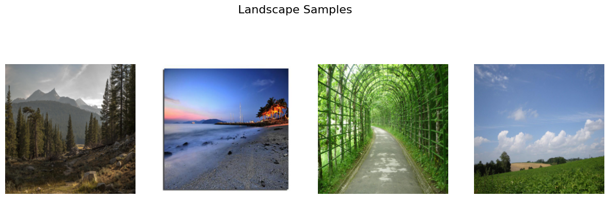
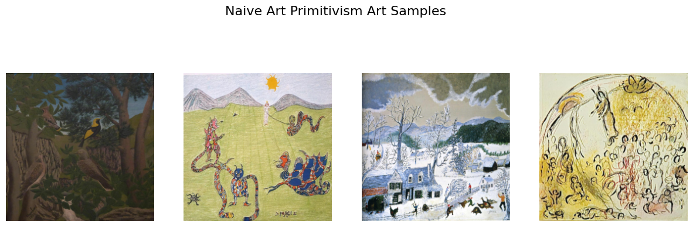
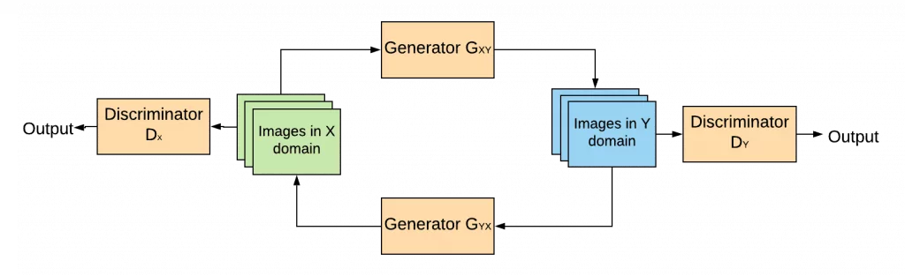
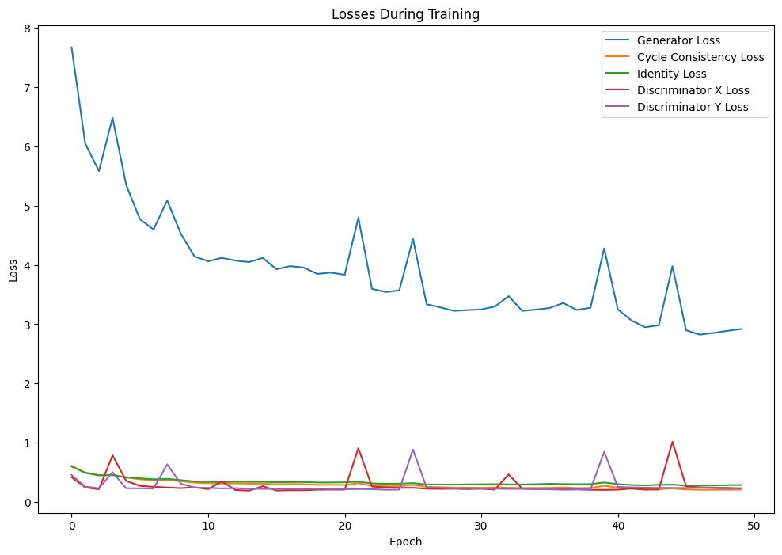
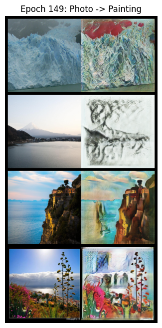

# Landscape → Painting (Unpaired) with CycleGAN

## Abstract

This project studies **unpaired image-to-image translation** from natural **landscape photographs** to paintings in specific art styles using **CycleGAN**. I implement ResNet-based generators and PatchGAN discriminators, train on landscape photos paired only at the **domain level** with artworks (no image-level correspondences), and analyze the effect of losses, training length, and style datasets on the quality of stylization. On held-out landscapes, the model transfers color palettes and textural cues while largely preserving scene layout; the **Naive/Primitivism** and **Cubism** styles perform best within the compute budget, whereas other styles need more data or training to stabilize. I report dataset composition, preprocessing, architecture, losses, and training schedule. 

---

## Problem & Goal

Traditional style transfer often requires **paired** examples; here I use **CycleGAN** to learn **bidirectional mappings** $X↔Y$ between real landscapes and paintings **without pairs**. The goal is to add style-specific color, texture, and brushstroke statistics while **preserving scene geometry** (rivers, mountains, sky) so outputs remain faithful to the source content but read as paintings. In this study I focus primarily on **Naive/Primitivism Art**, while also probing **Cubism, Pop Art, Ukiyo-e, Renaissance (Northern), Post‑Impressionism,** and **Pointillism** to understand style fit and data requirements. 

---

## Data & Preprocessing

The landscape domain comprises **~4,000** photographs (domain *X*). Style domains (domain *Y*) include: **Primitivism/Naive (~2,500)**, **Cubism (2,235)**, **Pop Art (1,483)**, **Ukiyo-e (1,000)**, **Northern Renaissance (2,500)**, **Post‑Impressionism (6,450)**, and **Pointillism (~500→~400 after pruning non‑landscapes)**. All images are resized to **256×256**, normalized to **[−1, 1]** (for `tanh`), and—given compute constraints—data augmentation is deferred for future runs. These choices ensure stable training and fair cross‑style comparisons under a fixed resolution and normalization regime. 

---

## Model Architecture

**Generators (G: X→Y, F: Y→X).** ResNet generators with an initial **7×7 conv (64 ch)**, two **3×3 downsampling** stages (**128, 256 ch**), a stack of **residual blocks** (two 3×3 convs per block with InstanceNorm + ReLU), and two **transpose‑conv upsampling** stages back to the input size, finishing with **7×7 conv + `tanh`**. Residual connections help preserve content structure as style is applied. 

**Discriminators (PatchGAN).** 70×70 PatchGANs with **4×4** convolutions, **LeakyReLU**, and InstanceNorm judge realism **locally** rather than for the entire image, encouraging texture‑level fidelity typical of brushstrokes. 

---

## Losses & Training

I use the standard CycleGAN objectives:

- **Adversarial (LSGAN):** MSE loss for D and G to match the target domain distribution.  
- **Cycle consistency:** **L1** on $F(G(x))\approx x$ and $G(F(y))\approx y$ with **λ_cycle = 10**.  
- **Identity:** **L1** on $G(y)\approx y$ and $F(x)\approx x$ with **λ_id = 0.5** (after tuning).  

Training runs with **Adam** $(\beta_1=0.5,\ \beta_2=0.999)$, **lr = 2e‑4**, for **50 epochs** as the main setting; **150 epochs** were tested for **Primitivism/Naive** but produced little visual gain despite lower loss, so **50 epochs** are considered sufficient under the current setup. Hardware: **RTX 3070**; **~8 hours per 50 epochs** per style domain. 

---

## Experiments

I trained separate CycleGANs per target style (landscape ↔ style). The **Primitivism/Naive** and **Cubism** models converged stably, whereas **Pop Art** over‑emphasized saturated reds; **Post‑Impressionism** exhibited oscillatory losses due to partial training; **Northern Renaissance** and **Pointillism** behaved like shallow color filters rather than coherent style transfer under the given budget. These observations are consistent with loss‑curve behavior and qualitative audits over epochs. 

---

## Results

### Qualitative evaluation

Because the data are **unpaired**, quantitative reference metrics like pixel MSE do not apply; I therefore rely on **visual inspection** across epochs and generator loss trends, with a practical rule that **Generator Loss < ~3** correlated with visually acceptable stylization in this setup. 

- **Primitivism/Naive — best overall.** Vivid palettes and simplified forms are transferred while **rivers, mountain ridges, and sky** remain recognizable. Increasing epochs from **50→150** adds detail but not necessarily aesthetic quality, aligning with the loss curves that flatten after ~50 epochs. 

- **Cubism — second best.** The model captures **geometric abstractions** and compositional cues (faceted planes, blocky segmentation), transferring the **global “Cubist” theme** even when brushwork is more impressionistic. 

- **Pop Art — limited success.** Strong color biases (overuse of **red**) indicate partial learning of palette statistics but weak structure mapping, suggesting the need for more data, balanced palettes, or stronger regularization. 

- **Northern Renaissance & Pointillism — underfit.** Outputs resemble **simple color filtering**, implying the model saw insufficient style‑consistent cues at 256×256 within the current budget. {index=11}  

- **Best galleries.** A curated gallery demonstrates consistent content preservation with convincing painterly textures across varied scenes. 

---

## Analysis & Discussion

1) **Training length vs. aesthetic quality.** Loss decreases beyond 50 epochs (e.g., 50→150) do **not** guarantee visual improvement; at times, longer training **degraded** aesthetics (over‑stylization, artifacts), arguing for early stopping guided by **visual checkpoints** rather than loss alone. :

2) **Identity loss tuning.** A high identity weight (e.g., λ_id≈5) made generators **near‑identity**, suppressing stylization; λ_id≈0.5 balanced style and content best in our setting. 

3) **Style fit matters.** Styles with **coherent, distinctive texture/color fields** (Primitivism/Naive, Cubism) adapted well. Styles with **large stylistic diversity** (Post‑Impressionism) or **fine detail realism** (Northern Renaissance) needed **more training data** and **higher resolution**. 

4) **Resolution ceiling.** At 256×256, fine brushwork cannot fully emerge; consider **super‑resolution** post‑processing (e.g., ESRGAN) or training at **≥512×512** when compute allows. 

---

## Limitations

- **Unpaired evaluation gap.** Objective metrics like FID/LPIPS were considered but deprioritized given compute and domain‑fit concerns; qualitative review + generator loss guided decisions. 

- **Compute budget.**  ~8h/50 epochs limited style breadth and resolution; some styles remained under‑trained. 

- **Resolution 256².** Outputs are capped at 256×256; scaling up requires architectural changes and more memory. 

---

## Ethics

Generated artworks should **not** be misrepresented as originals of the target movement. Datasets may include copyrighted works; ensure licenses are respected for training/redistribution. When exhibiting or publishing, disclose **model type, training corpus, and limitations** to avoid misleading audiences about authorship or technique.

---

## Future Work

- Train **longer** with **augmented** style corpora and **style‑balanced sampling** (esp. Post‑Impressionism).  
- Add **perceptual losses** (VGG‑based) and/or **style/content weighting schedules** for better texture‑content trade‑offs.  
- Integrate **super‑resolution** (e.g., ESRGAN‑Real) for 512–1024 outputs; explore **StarGAN/StyleGAN** variants for multi‑domain control. 

---

## File Descriptions

- **`cyclegan.ipynb`** — complete training notebook: data loaders, ResNet generators, PatchGAN discriminators, adversarial+cycle+identity losses, scheduling, and visualization utilities for intermediate results and loss curves.  

---

## References

- **Zhu, J‑Y., Park, T., Isola, P., & Efros, A. A. (2017).** Unpaired Image‑to‑Image Translation using Cycle‑Consistent Adversarial Networks. *ICCV*.  
- **Isola, P., Zhu, J‑Y., Zhou, T., & Efros, A. A. (2017).** Image‑to‑Image Translation with Conditional Adversarial Networks (PatchGAN). *CVPR*.  
- **He, K., Zhang, X., Ren, S., & Sun, J. (2016).** Deep Residual Learning for Image Recognition (ResNet). *CVPR*.  
- **Ulyanov, D., Vedaldi, A., & Lempitsky, V. (2016).** Instance Normalization. *arXiv*.  
- **Project report (Persian)** with full details, results, and figures. 